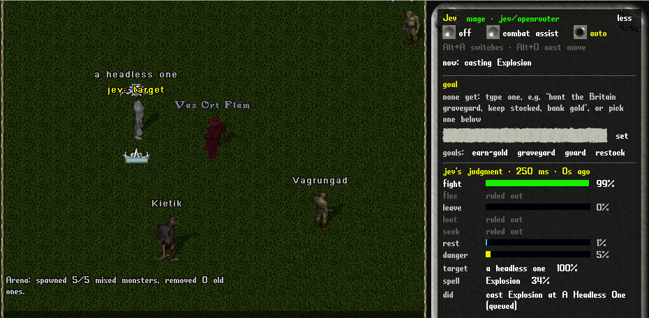
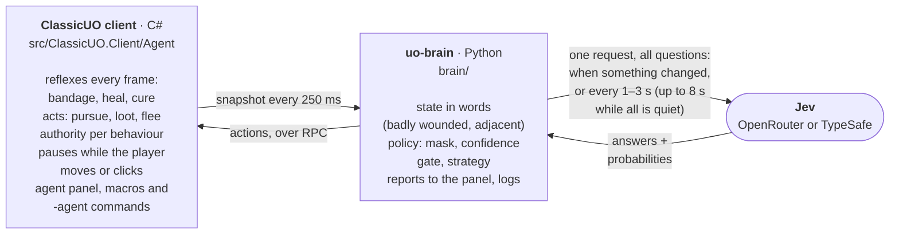

<h1 align="center">ClassicUO with a Jev agent</h1>

<p align="center">
  <b>An AI agent inside the Ultima Online client.</b><br>
  It fights beside you, or plays on its own towards a goal you give it in words.
</p>

<p align="center">
  
  
  
  
  <a href="LICENSE.md"></a>
</p>

<p align="center">
  <a href="#quick-start">Quick start</a> ·
  <a href="#how-it-works">How it works</a> ·
  <a href="#documentation">Documentation</a> ·
  <a href="docs/results.md">Results</a> ·
  <a href="docs/reference.md">Reference</a>
</p>

<p align="center">
  
  <br>
  <sub>A test mage in the arena on auto. Jev picked the headless one ("jev: target") and Explosion; the panel shows its judgment, answered in 250 ms.</sub>
</p>

This fork of [ClassicUO](https://github.com/ClassicUO/ClassicUO) adds an AI agent that can
play alongside you or play on its own. Its moment-to-moment decisions come from "System One"
models, which answer typed questions (pick one of these options, yes or no, rate this) with
probabilities in about 100 ms: [Jev](https://docs.typesafe.ai), TypeSafe's, and since 2026-10-12,
for most calls and the fights among them, Microsoft's Decision 1, which played the fights better.
Jev keeps the calls it measured better at ([which model answers](docs/seeing-what-it-does.md#which-model-answers)).
A planner model (Claude Haiku) chooses what to do next in auto mode. Ordinary code does
everything that has a right answer: healing thresholds, pathfinding, looting mechanics, safety rules.

| Feature | What it does |
|---|---|
| **Combat assist** | You drive. It fights beside you, keeps you healed, and does Jev's next move on a key. [Play states](docs/playing.md#play-states-and-keys) |
| **Auto, towards a goal** | "Hunt the undead at the Britain graveyard, bank the gold": a planner model (Claude Haiku) chooses each step (travel, hunt, bank, buy, sell) and Decision 1 fights, with Jev's calls on when to move on. [Goals](docs/goals.md) |
| **Character types** | Warriors, mages, archers, tamers and bards, two hybrids, and on AOS-era shards necromancers and paladins, told apart from the skills. [Character types](docs/playing.md#character-types) |
| **Plans for fights** | The planner can give the fights a shape for the place and the character (pull one at a time, back off to heal, hit a crowd with area spells) as a small state machine, and Jev runs it. [Plans](docs/goals.md#plans-for-fights) |
| **Strategy in your words** | "Never flee, finish the weakest first": Jev weighs it in every decision, and code enforces what it compiles to. [Strategy](docs/playing.md#strategy-in-your-own-words) |
| **The agent panel** | What Jev is thinking, in game: its probabilities, choices and actions for every decision, and a live view of every model call with the options and Jev's pick. [Panel](docs/playing.md#the-agent-panel) |
| **World knowledge** | Places, spawns, creatures, routes and past hunts for each shard, with Jev picking the facts that matter. [World knowledge](docs/world-and-memory.md#world-knowledge) |
| **Several agents and parties** | Several agents on one server, NPCs with lives of their own that hear and answer each other, and parties that form up and go into a fight together on one plan, hold a line, fall back and come back in, go to a companion that is set upon, call out, raise their fallen, are a party in the game too (its loot rights and party chat), walk together and talk the hunt over at the inn. [Several agents](docs/fleets.md) |
| **A hamlet of AI residents** | Agents who live in one place: a home each in Cove, neighbours they know by name and trade, work that takes them out and brings them back, and talk among themselves; measured against the same characters told nothing of the place (time in the hamlet and at home, homecomings, work, who talked with whom, what each remembers of the others). [A hamlet](docs/fleets.md#a-hamlet) |
| **Companions for your own character** | A party whose leader you play yourself: the agents keep beside your character, fight what is on it or them, heal it, and take your orders in your own words: to come along, to wait ("hold up a moment, I'll scout ahead"), to go on ahead somewhere and wait for you there ("off to the inn with you, see you there", "meet me at the east bank"), to run an errand and come back ("get me 10 bandages from the healer"), or to sit down and talk the hunt over with you; and in a fight, to go for the creature you name ("kill the mage first"), to fall back to you, or to heal you now. They change how they play at your word ("feel free to loot", "nobody runs", "quiet, all of you"), and say what they have changed. With personas they talk with you on the road too: each one a line is for answers it, and they say no to what they won't do. A wall between you doesn't stop them hearing you within earshot: they read your lines from your own client. [A party for the player](docs/fleets.md#a-party-for-the-player) |
| **Memory and long goals** | Each character keeps what happened to it and what it learned (leaves, deaths, refused goals, the planner's lessons) across sessions, and works towards long goals (a skill, gold to save, places to learn) with progress measured by code. [Memory](docs/world-and-memory.md#the-characters-memory) |
| **Measured** | A judgment benchmark measures where Jev beats fixed rules, with scenarios built so the obvious rule gets them wrong. [Results](docs/results.md#judgment-benchmark) |

> [!NOTE]
> **Status:** works end to end against a local ModernUO server, with the models reached
> through OpenRouter, for all of the character types. Not yet tried on a public shard
> ([what that needs](docs/public-shards.md)); see also the [known limits](docs/known-limits.md).

## Quick start

You need macOS on Apple Silicon, the .NET 10 SDK, the Xcode command line tools (NativeAOT
links with clang), [uv](https://docs.astral.sh/uv/) (the brain needs Python 3.13 or later)
and an OpenRouter key, which Jev and the planner share. No Windows machine is needed.

```bash
# 1. Build the client
git submodule update --init --recursive
dotnet publish src/ClassicUO.Client/ClassicUO.Client.csproj -c Release -r osx-arm64 -o bin/osx-arm64

# 2. Game files: the official UO client, straight from EA's patch servers
python3 tools/uo-download/download_uo.py --out ~/Workspace/UOClassic

# 3. Local test server (ModernUO in ~/Workspace/ModernUO; setup in tools/modernuo/README.md)
~/Workspace/ModernUO/start-agent-server.sh

# 4. Model key, saved to brain/.env (gitignored). OpenRouter is used when present.
#    Or skip this: copy the key and click "paste key" in the agent panel.
brain/set-openrouter-key.sh          # prompts without echoing; or: pbpaste | brain/set-openrouter-key.sh

# 5. Play. Run the client from its folder: settings.json is read from the current directory.
cd brain && uv sync && cd ..
(cd bin/osx-arm64 && ./cuo -agent_port 5577 &)
# For an NPC or a benchmark lane, a client without a window: add -headless (see "Without a window")
```

> [!IMPORTANT]
> The first launch writes `bin/osx-arm64/settings.json` and stops, because it has no client
> version yet. Set these, then launch again:
>
> ```json
> "ultimaonlinedirectory": "/Users/<you>/Workspace/UOClassic",
> "clientversion": "7.0.117.1",
> "plugins": []
> ```

Accounts on the test server are created on first login (`admin`/`admin` is the owner). In
game, **Alt+A** or the panel turns the agent on, and that starts the brain for you.

### Driving it from a terminal

Instead of the panel, e.g. for the arena:

```bash
cd brain
uv run uo-brain login --account warrior --password warrior --create-warrior Brutus
uv run uo-brain say "[AgentGo"; uv run uo-brain say "[AgentKit"; uv run uo-brain say "[AgentArena 6"
uv run uo-brain run --mode auto --log logs/run.jsonl

# Or a mage, with a ready-made strategy
uv run uo-brain say "[AgentKit mage"; uv run uo-brain strategy template nuker
uv run uo-brain scenario --kit mage --monsters 4 --log logs/mage.jsonl
```

With no model key, `--judge heuristic` runs the same loop on fixed rules (the baseline). The
`[Agent…` commands come from the test server ([list](docs/reference.md#test-server-commands)).

### The client starts the brain

When the agent is turned on and nothing is connected to
its port, the client runs `uv run uo-brain run` in the repository's `brain/` folder,
restarts it if it exits (waiting longer each time), and stops it when the agent is turned
off or the client closes. Its output goes to `brain/logs/client-brain.log`, its decisions
to `brain/logs/auto-<date>.jsonl`. A brain you start in a terminal takes precedence. In
settings.json, `agent_start_brain: false` turns this off (or `-agent_start_brain false`),
and `agent_brain_dir` points at a brain folder elsewhere. The *paste key* link saves the
clipboard to `brain/.env` (mode 600) and restarts the brain; the key is never shown.

**Razor and other plugins:** `scripts/build-naot.sh` builds upstream's release layout instead (osx-x64, the client as a
library loaded by the net472 `ClassicUO.Bootstrap` host). That is only needed for managed
assistant plugins such as Razor.

## How it works



1. **The client snapshot** gives the player, the creatures and corpses within 18
   tiles, new journal lines and the agent's own state.
2. **The brain describes the situation in words.** Jev reads "badly wounded,
   adjacent, to the east" far more reliably than raw numbers and coordinates. How
   strong each creature is comes from its stats in the world store ("an ogre lord, far
   stronger than you: do not fight it alone", "a spellcaster", "rooted to the spot and can't
   follow you", "only fights back if attacked"), and supplies are worded
   too ("running low: 12 bandages and 1 heal potion left").
   Candidates get short ids (`t1`, `c1`, `i1`) so the model can only pick things
   code has already checked. Other players' speech is never sent to the model.
   Up to three facts from the world store that Jev picked for this place go in as
   `what_you_know_about_this_place` ([which facts reach the decisions](docs/world-and-memory.md#which-facts-reach-the-decisions)).
3. **One Jev request asks every question that could matter**:
   - `intent`: fight, flee (for a moment), leave (the area: run until nothing is in sight), loot, seek or rest
   - `in_danger`: will the character die soon if it keeps fighting?
   - `leave_now`, only when there's a reason to (a far stronger creature within 12 tiles, a pack coming at it that together outweighs it, supplies nearly gone with two or more creatures close, or picked world facts with a creature in view): should it leave now? Jev judges this better as its own yes/no than as one of six intents: with an ogre lord adjacent it still gave fight 80%.
   - `target`: which creature to attack, or none of these. A "none" at 0.5 or more is taken as an answer (unless something is on the character): the character doesn't fight, and doesn't go looking for a creature either, however sure the intent is of seeking. A creature that two walks to seek it found no path to is left out for the rest of the hunt, unless it comes at the character (cuo-20l): a fleet NPC once sought a sewer rat under the street for six minutes, every walk "no path". The client gives up on attacks the same way (cuo-2ct).
   - `spell` (mages): which attack spell to cast next
   - `corpse`: which corpse to loot first
   - `take_iN`: is this item worth picking up?
   - `blessing` (paladins): which chivalry blessing to use in this fight
   - `stand`, with `--spots jev` and only when a run could come: where to go if it runs, leaves or steps back, from about 50 places the client offers ([where it runs](docs/playing.md#where-it-runs))
   - with a [plan](docs/goals.md#plans-for-fights), `go_<step>`: should it move on to that step now? Only the current step's moves are asked.

   Code uses the answers that apply and ignores the rest. Something new coming at the
   character counts as a change, so the next decision is asked at once rather than at the
   next second's tick.

   **Jev isn't asked when its answer can't matter or can't be new** (cuo-df8):
   - **Nothing to choose:** no creature, corpse or item in view, and nothing asked but what next
     and the danger. The policy could only rest whatever Jev said.
   - **The same state:** worded exactly as at the last call, with the same questions. That call's
     answers are used again, for up to a minute, but never after an unsure answer (that is asked
     again, as before). Jev's answers to the same state vary only a little (by 0.01 on average,
     at most 0.2, in a fleet's logs).
   - **All quiet:** not fighting, no pet fighting, nothing within 7 tiles or coming at the
     character, health not falling. Each decision on the clock that did nothing doubles the wait
     for the next, up to 8 s, and the quiet ending (a creature within 7 tiles, a fight, a fall in
     health) decides at once.
   - **Defending only** (the fight loop beside travel, rest and errands, which never seeks or
     loots): a creature that comes into view counts as a change once it is within 7 tiles or in
     war mode, and a corpse doesn't count. Walking through town, every cat, dog and bull that came
     into view was a call.

   The policy still decides each time, on the last answers or none, so its own rules and timers
   (leaving, songs, meditation, a plan's time limits) run as before, and the client's reflexes
   don't wait on the brain. `UO_BRAIN_ASK_EVERY_TICK=1` in the brain's environment asks Jev at
   every tick and never stretches the clock, as before.
4. **The policy is code.** It masks options the facts rule out (no looting with a
   monster adjacent), requires the intent and the danger judgment to agree before
   fleeing, keeps its current course when confidence is low, and applies your
   strategy settings. Its own emergency flee runs when the character is below 25% health,
   Jev is at least 0.9 sure of the danger and no heal potion can be drunk in the next two
   seconds; it keeps running while anything aggressive is within 8 tiles, rather than turning
   back once the first run has opened a gap.
5. **The client has the last word.** It checks the behaviour's authority before
   anything happens, and the brain may only ever attack monsters.

## Documentation

| | |
|---|---|
| [Playing with the agent](docs/playing.md) | Play states and keys, the agent panel, reflexes, safety rules, leaving and packs, where it runs, other players, line of sight; the character types; strategy in your own words and its templates |
| [Goals and the planner](docs/goals.md) | Auto mode towards a goal: the planner, after a death, travel, banking, shops and hunting; plans for fights |
| [World knowledge and memory](docs/world-and-memory.md) | The world store and which facts reach the decisions; a character's own memories, the heartbeat and daily digest, long goals |
| [Seeing what it does](docs/seeing-what-it-does.md) | Logs, reports and filming a run (with the screen locked too); what every AI call costs and budgets; which model answers each kind of call; after-action review |
| [Several agents on one server](docs/fleets.md) | Fleets of agents and NPCs, rules of play, a party in a fight, on the road and at the inn, a party for the player, a hamlet of residents; clients without a window |
| [Results](docs/results.md) | Every measured result, with its date and the command that produced it |
| [Playing on public shards](docs/public-shards.md) | Pre-AOS rules and connecting to UO Renaissance |
| [Known limits](docs/known-limits.md) | What doesn't work yet, or hasn't been measured |
| [Reference](docs/reference.md) | In-game commands, `uo-brain` subcommands, the client's RPC, snapshot and act verbs, test-server commands, and where things are in the code |

## Credits and licence

- **ClassicUO.** This is a fork of [ClassicUO](https://github.com/ClassicUO/ClassicUO), the open
  source Ultima Online Classic Client by andreakarasho and its contributors, built on
  [FNA](https://github.com/FNA-XNA/FNA). Its own README, with its downloads, support links and
  the projects it drew on, is kept in [docs/classicuo.md](docs/classicuo.md). If the client is
  useful to you, support it on [Patreon](http://www.patreon.com/classicuo).
- **Models.** [Jev](https://docs.typesafe.ai) is TypeSafe's; the planner is Claude Haiku (or
  Sonnet), reached through [OpenRouter](https://openrouter.ai).
- **Licence.** BSD 2-Clause, as upstream ([LICENSE.md](LICENSE.md)).
- **Game files.** No copyrighted game assets are distributed. You need the official client
  files, which `tools/uo-download` fetches from EA's patch servers. Using a custom client to
  connect to official UO servers is forbidden.

Ultima Online® © Electronic Arts Inc. All rights reserved.
