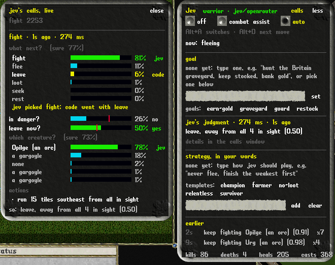

# Playing with the agent

<sub>[← README](../README.md) · [all documentation](../README.md#documentation)</sub>

## Play states and keys

There are two ways to play, and one key between them:

- **Combat assist:** you drive. The agent fights alongside you and never walks the character.
- **Auto:** the agent plays on its own.
- **Off:** nothing runs.

**Alt+A** switches between combat assist and auto (from off it starts combat assist), and
**Alt+D** does Jev's next move. Both are ordinary macros (*Agent: switch* and *Agent: next
move*) added once per character; rebind or delete them in Options → Macros. A key you
already use is left alone, and the macro is added without a key.

**Combat assist** follows your target: it attacks, or casts at, whatever you attacked or
targeted. A setting chooses what else it takes on by itself (`-agent engage`, or the
*engages* row in the panel):

| setting | it engages |
|---|---|
| `follow` | only what you attack |
| `defend` (default) | that, and anything attacking you |
| `nearby` | any monster within 8 tiles |

- **A warrior** keeps swinging and bandages between hits; this works with no brain running.
- **A mage** casts the next spell from your strategy, or Jev's pick, at your target, and says above your head when the target is out of spell range.
- **It never walks or flees for you:** when Jev judges the fight is going badly, it says so ("this fight is going badly, get out") and leaves the moving to you.
- **On your key:** set *fights* to *on your key* (`-agent set fight suggest`) and Jev only picks the move; Alt+D does it.

**The next-move key** (Alt+D, `-agent next`) does Jev's pending suggestion if there is one,
otherwise the combat move from its latest decision (a cast, a target switch), otherwise a
bandage if you're hurt. You decide when, Jev decides what.

**Auto** is fully autonomous play. Give it a goal and it works towards it
([Goals and the planner](goals.md)).

**Handing over control:**
- **In auto,** moving, clicking in the world or using the arrow keys is a short override: control comes back to you for 4 seconds, any walk the agent started stops, and only the healing reflexes keep running. The Alt+A key is the real switch.
- **In combat assist,** your input only pauses the agent's own movement (looting a corpse, if you accepted it). The fight goes on while you walk, and a spell it is casting still goes off at its target unless you clicked in the world.
- **Your target sticks:** if you attack a different monster yourself, the agent follows your choice.
- **Your spell cursors are yours:** if you click in the world while one of the agent's attack spells is being cast, its target cursor is left to you.
- **Panel clicks don't count:** clicking the panel doesn't pause the agent.

The hand-back and the keys were checked with real mouse and keyboard events ([results](results.md#real-input)).

**Authority per behaviour.** Each behaviour has its own authority: `off`, `suggest` or
`auto`. The play states are presets:

| state | heal / cure / potion | fight | loot / misc | move |
|---|---|---|---|---|
| `off` | off | off | off | off |
| combat assist (`assist`) | auto | auto | suggest | off |
| `auto` | auto | auto | auto | auto |

- **Overrides:** change any single behaviour, e.g. `-agent set fight suggest` while in combat assist.
- **Behaviours:** `heal` (bandages), `cure` (cure potions), `potion` (heal potions), `fight`, `loot`, `move`, `misc`.
- **Saving:** settings are saved per character. A character saved in the old assist mode starts in combat assist.

## The agent panel

Jev's thinking is shown inside the game, in a UO-style panel that opens beside the game view
whenever the agent is on or a brain is connected. It shows:

- **Play state buttons:** off, combat assist and auto, with the keys that switch between them and do Jev's next move.
- **Combat assist settings:** what it engages (your target, also attackers, or anything near) and whether it fights on its own or waits for your next-move key.
- **The goal** (auto mode): what you asked for, the step the planner is on and why, *pause*/*resume* and *clear*, an entry box, and the goal templates (see [Goals and the planner](goals.md)).
- **The brain's state** in the title row ("brain starting", "brain running"), then the character type and judge it is playing with ("warrior · jev/openrouter") from the moment it connects, goal or no goal, and a *paste key* link while there is no model key.
- **Watch out:** a red, criminal or unknown player within 8 tiles.
- **What the agent is doing:** for example "fighting Vorgak", "casting Explosion" or "bandaging", and "you're driving" or "you have the controls" while you're playing.
- **Jev's judgment** for the latest decision:
  - a bar for each intent with Jev's probability, plus options the facts ruled out;
  - the danger judgment;
  - the target and spell it picked, with confidence, or "your strategy" when your strategy chose the spell;
  - what was done, and the latency, or why Jev wasn't asked ("not asked: same state as the last call", "nothing to choose").

  While the calls window (below) is open it has all of this, question by question, so the panel keeps one line for the decision ("fight a gargoyle with Explosion (0.83)") instead of showing the same bars twice.
- **A pending suggestion** with an *accept* link.
- **Your strategy and how Jev read it**, an entry box to add a line, and the template links (see [Templates](#templates)).
- **Earlier decisions**, with repeats collapsed ("fight an orc x5").
- **Kills, deaths, heals and casts.**

When Jev picks a new target, "jev: target" appears above that creature in the world. *less*
collapses the panel to a few lines; its position and whether it is collapsed are saved per character.

**Jev's calls, live.** The *calls* link in the panel's title row (or `-agent calls`) opens a
window beside it that shows every model call as it happens, not just the latest intent:

- **The latest fight decision, question by question:** what next, which creature, which spell or blessing, and so on, each option as a bar with Jev's probability, its pick marked *jev* in green and, where code went with something else (a code rule, your strategy's spell, an unsure answer), that marked *code* in gold. A yes/no (in danger?, leave now?, a [plan](goals.md#plans-for-fights)'s next step?) is one bar with the cut that decides it in red, and the verdict.
- **What was done about it:** each action of that decision in words, with the way a move went: "run 15 tiles northwest from all in sight", "step back 4 tiles south", "walk 12 tiles east", "attack a gargoyle", "cast Explosion at a lich", and the result when it didn't simply go through (refused, out of reach).
- **The latest of each other kind of call:** Jev's routine questions inside a hunt with its verdict, its pick of world facts (each fact with its score, the kept ones in green), a strategy read, and the planner's goals and world queries with their reason and cost.
- **How many calls of each kind** there have been, and what they have cost: the total, the rate an hour, the dearest kinds of call, and the budget if one is set (in red once it's over). Each call's header gives its own cost. A fight decision Jev wasn't asked for says why in its header instead, and doesn't count as a call.

<p align="center">
  
</p>

<p align="center">
  
</p>

## Reflexes

The client runs these without the brain:

- **Bandages:** bandage yourself below 85% health, or when poisoned.
- **Heal potion:** drink one below 40%, with the 10-second cooldown respected.
- **Cure potion:** drink one when poisoned and hurt.
- **Healing spells** (characters with no bandages): Heal below 65%, Greater Heal below 50%, and Cure when poisoned if no cure potion is ready.
- **A paladin's prayers:** Close Wounds below 50%, bandages or not (a bandage takes seconds), and Cleanse by Fire when poisoned with no cure potion ready.

Adjust them with `-agent bandage 80` and `-agent potion 35`. They're also
available on their own: combat assist with no brain running heals you and keeps a warrior swinging.

## Safety rules

These are in code, whatever the model says:

- The brain only attacks monsters: grey or red, not human, not a pet.
- Other players' speech goes to neither the model nor the reflexes.
- Actions are a fixed list.
- Gold, bandages and potions are always taken; anything else needs a "worth taking" judgment.
- Other players are never attacked, never named to the model (they appear as "a red player", "a criminal player" or "another player") and never named in the world store.
- A creature with a person's shape is a monster, and no player, when it has a savage's body (savages, savage riders and shamans) or a title in its name ("Garth the brigand"), as townsfolk are told from players (cuo-ea4). Before 2026-10-19 every one with a person's shape was taken for a player: the savages at the Cove Orc Fort were never fought and were reported as red players.
- **Attended play** (`agent_attended_minutes` in settings.json, 0 by default; 3 in the UO Renaissance profile, cuo-49t): with no input from the player for that many minutes the agent does nothing at all, not even heal, until they touch the controls again or turn a mode on. It drops what it was doing, takes the character out of war mode, refuses the brain's actions ("the player is away from the keyboard"), and the panel says "waiting for you". The snapshot's `agent.away` says so. A public shard's rules can forbid killing monsters unattended by any means. What it can't stop is the server's own auto-defence: on ModernUO (and RunUO) a character that is attacked swings back at its attacker, war mode or not, as any player's does who steps away. Checked live twice (2026-10-27, one minute, an orc set on a warrior in assist mode once it was away): the agent attacked nothing, bandaged nothing and was back the moment a mode was turned on, and the orc still lost 86% and 80% of its health to the character's own swings.
- The brain only loots corpses of creatures the client saw die as monsters. Taking from anything else (an animal, a townsperson, another player) can be a crime: in a test, looting a rabbit's corpse in Britain made the character a criminal and the guards killed him.

## Leaving and packs

In auto mode the agent leaves a fight it can't win: it runs until nothing hostile is in
sight, keeps running from whatever is still there for 40 seconds, and for two minutes after
that doesn't go looking for creatures, only fights what comes at it (within 3 tiles for a
warrior, within its reach for a mage, archer, tamer or bard). In a pack round the
warrior got away untouched, went after the orc it had left once the 40 seconds were up, and
walked back into the gargoyles.

- **It runs.** Every move of a fight runs, as players do: a flee, a step back, a leave, a chase. The client's pathfinder only ran walks longer than 14 tiles, so a 10-tile flee, a step back from melee, and a 15-tile leave on a diagonal (11 tiles each way) walked at half the speed of the monsters chasing it. Only a trip or a follow asked to walk walks, and that runs too while there is danger ([pace](goals.md#travel-banking-shops-and-hunting)).
- **No idle gap.** A flee counts as running only while the character is moving: held for a fixed 6 seconds, a 3-second run left it standing for the rest, with nothing deciding and whatever followed hitting it.
- **Packs.** The state says what is coming at the character together (fighting, within 12 tiles, or already on it), weighed against it: a creature far stronger than it counts 4, stronger 2, weak 0.4, a fair fight 1 scaled by its hits against the character's (between 0.5 and 1.5, so two spectres don't weigh as two gargoyles), a spellcaster half as much again (it hurts from a distance, running or not), and each by its health (`coming_at_you`: "2 gargoyles (a fair fight and a spellcaster each); together far stronger than you: too many to fight at once"). From 2.5 on, Jev's `leave_now` is asked; and at that weight with two or more coming, code leaves while they are still coming (2.5 with no strategy, less for a cautious one, more for an aggressive one; never under a never-flee strategy, never in combat assist). The open-goal soak runs died to two gargoyles and a reaper while Jev's leave stayed at 0.39–0.44, and to a troll, a harpy and a ratman (2.5) when the cut was 3.
- **Not back too soon.** In a session, a hunt that ended in a leave from creatures stops the planner sending the character within 30 tiles of there for 30 minutes; the refusal says why and how long is left. With 15 minutes, the planner sent it back as soon as they were up, and it died there. A hunt that found its ground empty (minutes with nothing hostile in sight) keeps the planner from hunting that ground again for 15 minutes, since its creatures come back one at a time. Either refusal names the nearest grounds where nothing is stronger than the character ([Hunting](goals.md#travel-banking-shops-and-hunting)).
- **Away from all of them.** Any leave with two or more creatures in sight runs away from every creature in view taken together, each counting the same whatever its distance, not from one of them; with one in sight, from it. Only code's pack rule used to do this: in a pack round with that rule off, Jev's own leave with an orc adjacent ran from the orc alone, 15 tiles north into three gargoyles, and the warrior died there. It used to count only those within 10 tiles, so a pack still further off gave no direction and the run went north, whatever was there. A blocked way out is now tried turned up to about 100 degrees either side (it was 70), then at half the distance: in a round on another lane of the test field, the warrior ran into a corner, where nine runs in a row failed and three gargoyles caught it.
- **Cornered:** when two runs in a row fail ("no path away") with something within 3 tiles, or four in a row whatever the distance, it stops trying to leave for 15 seconds and fights what is close, whether code or Jev wanted to leave. With nothing close yet it keeps leaving, straight away from the nearest creature instead of from them all, which is another heading: in a soak run a warrior that had left three gargoyles three times found no path twice by the graveyard wall while they were still far off, was held in the fight for 15 s while Jev said leave at 0.8-0.9, and died (cuo-y4l).
- **Losing fast to one creature:** the state says when health has fallen 20 points or more in the last 6 seconds (`health_falling`), and a fall of 30 with a creature close and health under 70% is a reason to ask Jev's `leave_now`, whatever the creature's strength words. Near death the emergency flee then needs danger 0.8 rather than 0.9. A lone gargoyle, "a fair fight", took a soak run's warrior from 58% to 20% in a second and killed it with leaving never asked and danger at 0.86 (cuo-8vk).
- **When to stop, Jev's call** (`--leave-stop jev`, cuo-fhf.6; off by default: in the bench, leaves of 9 s instead of 32 s, but three times as many, and the same wins, [results](results.md#when-a-leave-stops)). The direction stays code's line away; while a leave goes on, the request Jev already gets carries one more yes/no, `stop_running`: is it safe to stop running now (what is still in sight is falling behind, no spellcaster can still reach it, health holds)? For it, each creature in sight says how it has moved against the character over the last 4 s (`moving`: "closing in: 12 to 7 tiles in the last 2 s", "keeping pace at about 10 tiles: it is following", "falling behind: 9 to 15 tiles in the last 4 s"); with only "far away" and war mode to go on, Jev answered 0.3–0.5 nearly every time, and with them 0.7–0.8 for what was falling behind and 0.1–0.2 for what was closing in. At 0.6 or more the leave ends, but not before 4 s of running, never with a creature on the character, and never under half health with a spellcaster in war mode within 12 tiles that can see it; at 0.4 or less, near the end of the 40 s, it runs on 10 s more, up to 90 s in all. The 2-minute pause on seeking after a leave stays. The bench logs showed code's fixed rule wrong both ways: half the leaves ran the full 40 s with something still in sight, a quarter of their runs went out with nothing coming, and half were caught again within 30 s of stopping.
- **With companions** (a party, cuo-4ar): companions within 10 tiles count in the odds. A creature's strength words are worked out against the party's hits together, both said where they differ ("stronger than you: a hard fight, with your 3 companions beside you (far stronger than you alone)"), and what is coming weighs against the party ("together a fair fight for your party of 4"). The shoot's wave (a lich, two bone knights, four skeletons) weighs about 7.6 against one warrior and 1.5 against four together, so the pack rule no longer sends everyone away from a fight five can win.
- **Told apart by name.** Several kinds share a body graphic, and the strongest used to stand for all: a black bear read as "far stronger" because a named boss bear shares its graphic. Creatures are now matched by name among the kinds with their graphic. One whose name is drawn from a list (a savage is "Khaonem") matches none, and stands for the most dangerous kind with its graphic, by difficulty and then hits: a savage's 23-27 a blow, not the savage shaman's 4-10 (cuo-m3n.6). Every graphic a kind can have counts: a male savage is 183 and a female 184, and only 184 used to be read (re-import the store, `uo-brain world import-modernuo`, to take it up).

In a session hunt, leaving ends the hunt (see [hunting](goals.md#travel-banking-shops-and-hunting)).

## Where it runs

By default code picks where every run, leave and step back goes: along the line away from the
creatures, the first point with a path. Jev only chooses whether to move. The runs that went
wrong were bad places Jev never saw: the warrior that ran from an orc into three gargoyles
(cuo-d28.11), the run into a dead end, the mage cornered for 40 seconds (cuo-y4l). With
`--spots jev` (`/spots` in the bench) Jev picks the place instead, from places the client offers;
with `--spots rule` code picks from the same places. It stays off by default: in the Jev bench it
lost to code's line away twice: 43/60 with 12 deaths against 47/60 with 3, and with places kept and
leaves sent far, 44/60 with 10 against 47/60 with 4. Code's own pick of the places (`--spots rule`)
tied with the line away, 48/60 against 49/60 ([results](results.md#where-it-runs)).

- **The places (client, `AgentSpots`):** with a monster in view, a snapshot asked for `spots`
  offers about 50 places by coverage, not by judgment: staying put; 16 bearings at 3, 8 and 14
  tiles (UO's square rings), each moved to the nearest tile within 1 to 3 tiles that the player
  can walk to, preferring one that isn't a dead end, and dropped when there is none; doorways in
  view, the mouths of narrow ways, beside the pet, and beside a guard or healer. The walk is
  worked out over the travel planner's grid round the player (map files, doors, remembered
  houses, impassable items in view), never through a creature's tile.
- **The facts per place:** the steps to get there (not the straight-line distance), the
  direction, every creature's distance from it (the 8 nearest), which of them within 12 tiles
  could see it there (the [line-of-sight](#line-of-sight) rule), which the walk passes next to (a
  creature already in melee reach counts only from the walk's third step: any way out takes a
  step or two beside it), and the room beyond it: how much ground a flood from there reaches
  without getting nearer the closest creature (under 12 tiles is a dead end, 100 or the edge of
  the grid open ground). It takes about 2.5 ms on the game thread (8 ms at most so far), only with
  a monster in view and a snapshot asking for it, and is worked out again at most every 0.4 s while
  the player stands still.
- **The question (brain):** each place in words, "8 steps west-southwest: nearest hostile an
  orc 8 tiles away, none within 3; out of sight of the spellcaster; open ground beyond", and for a
  mage or archer also how far its target would be from there and whether it could see it. The
  `stand` question lists them by bearing from north, clockwise, nearest first, with staying last,
  since Jev leans towards the first option (`/spotsrev` lists them the other way round, to check
  its picks don't follow the order). Its guidance: no creature within 3 tiles once there, away
  from all of them, out of sight of spellcasters, open ground beyond, no dead ends, no walk past
  a creature; a caster or archer also wants its target in range and sight, a tamer stays near
  its pet. It is asked only when a run could come: leaving already, a reason to leave or a pack
  coming, a creature close with health under 50%, falling fast or two close, two on a mage or
  archer, or a tamer's pet losing. At about 35 tokens a place it adds 1,500 to 2,000 input tokens
  to those calls.
- **The run:** every run (`flee`, including leaving and code's own floors: the emergency flee,
  leaving from players and packs, a tamer's pull back) and every step back (`kite`) goes to the
  place Jev gave most weight among those allowed: not staying put, not beside a creature, and for
  a step back no more than 8 steps. Where Jev wasn't asked, code picks: no walk past a creature,
  no dead end, then furthest from the nearest creature (5 tiles is enough for a step back), not
  closed in, seen by the fewest spellcasters, the shortest walk. The client walks there
  (`flee {x, y}`, `kite {x, y}`), and only when its pathfinder finds no path there does it fall
  back to the line away ("no path to the spot; 15 tiles north"). The decision log has the place,
  who picked it and Jev's probability for it (`spot`), and the calls view the `stand` question.
- **Keeping to it** (cuo-fhf.5): a run or step back keeps going to the place it set off for, and
  isn't asked again every decision ("still to 1000,1008"). It picks again once the place is
  reached, after 12 s, or when a creature is nearer the place than the character is. A leave is
  offered only the 8- and 14-tile rings and landmarks at least 8 steps off; when there are none,
  anywhere. The first Jev bench had re-picked every decision, and its leaves zigzagged
  ([results](results.md#where-it-runs)).

## Other players

The client watches for other players within 8 tiles: **red** (murderers), **criminals**,
and **unknown** players, meaning people without an NPC title ("Lucy the healer"). Titles come
from item properties, or, on shards without them (pre-AOS), from one single click per
person; until a title is known, only red and criminal players are flagged.

- **Combat assist:** a warning above their head, in the panel and in the journal, once a minute per player.
- **Auto:** it leaves: a red or criminal player within range makes the character run 15 tiles away from them, and a hunt ends ("a red or criminal player came close") so the planner can choose somewhere else.
- **Defensive only:** the agent never attacks a player, whatever the mode.
- **The world store** notes "A red player was seen here." for the area, never who.

## Calling the guards

In a town the world store has as guarded, the character says "Guards!" when a creature or player within 13 tiles
has turned criminal, which one does by harming an innocent (its notoriety in the snapshot goes from grey to
criminal), and again every 8 s while one is still about, or at once when the character is hit (a creature that
followed it in from outside is a candidate only from its first harm inside the town: a savage rider that followed a
resident home from the orc fort took her from full health to a fifth in one blow at her door). A red creature
(notoriety "murderer") fighting close by, in war mode or attacking the character, is called on too: a savage is red
to the client whatever it does, though harming an innocent makes it criminal and a candidate like any other, and
savages killed all seven who died in a lands hour of the hamlet, one at the watchman's gate in Cove, with the call
never made (cuo-m3n.20). A red player is not. It runs beside every goal, in the session's look at each
snapshot, and the session log has a `guards` record of each call. On ModernUO a guard then comes at once for any
such one within 14 tiles of the caller and kills it; without a call, one comes only if a townsperson stood within 8
tiles of the creature when it first struck (`GuardedRegion`). A lich that followed a hamlet resident home killed
her at Cove's healer's house, and nobody called (cuo-m3n.14). Staged there, a lich took a warrior from 95 hits to
25 in 8 s with no call; called, a guard killed it before it struck ([results](results.md#calling-the-guards-cuo-m3n14)).
A creature the character struck first harms it lawfully, so no guard comes for it.

## Line of sight

The server doesn't shoot an arrow through a wall, and doesn't take a spell's, a song's or a pet
order's target through one either: an archer just stands there, and a spell aimed through one is
lost. The client works out what the character can see by the server's own rule,
ModernUO's `Map.LineOfSight`, copied line for line in `AgentSight.cs` and run over the client's
map. A straight line goes from eye height (14 above where each one stands; a ground tile is aimed
at one above the highest corner of its land). Land rising through the line blocks it, and so does
any static, house piece or item flagged NoShoot or Window that spans its height on a tile, except
on the target's own tile. A door where the line starts doesn't block. Nothing past 25 tiles is in
sight. Floors and roofs (NoShoot in the tile data) only block a line that crosses their height, so
indoors they don't.

Servers differ in two places of that rule, so whose rule the client follows is a setting
(cuo-2ad): `agent_sight_rule` in settings.json, `-agent_sight_rule` on the command line for one
launch, or the `sight` method's `rule` while the client runs. The snapshot's `agent.sight_rule`
and the `sight` reply say which is in force.

- `modernuo`, the default, is the local test server's. ModernUO never lets a door on the tile the line starts from block, nor any item on the tile it ends on. The line is drawn from the lower point to the higher, so either can be the viewer's own tile.
- `runuo` is RunUO's from 2.3 on, which has no such clause: a character standing on a door's tile, which ModernUO lets see out, is behind a wall there. That is the one case where the client on ModernUO's rule would aim and a RunUO shard refuse, without a word for a weapon swing.
- `runuo22` is RunUO's up to 2.2, which also lacks a one-unit allowance the other two have: there a piece or land whose base is one above the line doesn't block, and one a unit above the target on the target's own tile does.

On everything else the three are the same, read from ModernUO's source and RunUO's (tags 2.0 to 2.4 and master).

- **The snapshot** has `in_sight` for each creature. Jev's state says "out of sight behind something" for one that isn't, and the target question then says it can still be fought by walking round, but one in sight comes first.
- **Target choice:** whatever fights from where it stands (a mage, an archer, a bard, a tamer sending its pet) takes on a creature out of sight only when none is in sight; Jev's pick of one out of sight is passed over otherwise. A warrior walks up to its target anyway, so its pick stands.
- **Spells:** a mage casts only at a creature in sight. Fields and summons go only on a tile beside the creature that the character can see, and an area spell is aimed only at a creature in sight. The client refuses a cast at a creature out of sight ("not in sight"); when a spell's cursor comes up with its creature gone out of sight, it waits up to 3 seconds while the character walks on, then lets the spell go.
- **Moving to see:** an archer or a caster engaged at range that can't see its creature walks towards it until it can, and stops there rather than walking into melee. A creature out of sight for 15 seconds is given up, as one out of reach is.
- **No blow landing:** in melee, next to its creature with none of the creature's health taken for 30 seconds, the client gives it up as out of reach too, for 5 minutes unless it moves, and a creature next to the character in war mode no longer counts as attacking it then; one that swung at the character in the last 8 seconds is never let go this way. In a lands hour of the hamlet a resident stood by an unhurt zombie in Cove's cemetery for 14 minutes, using 33 of her 40 bandages, until her hunt's time was up, and ten earlier hamlet logs of 96 show the same (cuo-m3n.22). It wasn't the ground or the sight between: a zombie set down on that tile later died in 5 seconds.
- **The server's word:** a "Target can not be seen" (or "Target cannot be seen. Try again.") after the agent's own target cursor marks that creature or tile out of sight for 4 seconds, in case the two rules ever part; a try-again cursor is let go. ModernUO sends it for songs, pet orders and bandages, and for Blade Spirits and Energy Vortex, but says nothing when another spell misses for sight, and an archer out of sight just doesn't shoot. So the client also counts, by its own rule and with the checks on or off, every aim at something out of sight (`agent.stats.aimed_unseen`) and the time spent engaged at range with the creature out of sight (`unseen_engaged_ms`), beside the server's messages (`not_in_sight`).
- **Checked against the server:** 2920 of 2920 pairs agree, around Britain and among test walls; in the line-of-sight benchmark the agent goes from 0 of 32 rounds won to 32 of 32 ([results](results.md#line-of-sight)).

## Character types

The brain tells how to play a character from its skills and what it has in hand, checking in
this order, or you name it with `uo-brain run --archetype warrior|mage|archer|tamer|bard|necromancer|paladin`:

| plays as | when |
|---|---|
| paladin | a book of chivalry, Chivalry 50 or more, and a melee weapon in hand with a weapon skill of 50 or more |
| necromancer | a book of necromancy, Necromancy 50 or more and at least as high as Magery and any weapon skill |
| mage-tamer | a spellbook, and Magery and Animal Taming both 50 or more |
| warrior-mage | a spellbook, Magery and a weapon skill both 50 or more, and a melee weapon in hand |
| mage | a spellbook, Magery 50 or more and at least as high as any weapon skill |
| tamer | Animal Taming 50 or more, and at least as high as any weapon skill |
| bard | Musicianship 50 or more, and a bard skill 50 or more and at least as high as any weapon skill |
| archer | a bow or crossbow in hand |
| warrior | anything else: melee, bandaging between hits |

### Mages

- **Range:** it engages from up to 7 tiles away and casts Jev's pick from the spells it can cast right now: the attack spells (Flamestrike, Energy Bolt, Explosion, Lightning, Mind Blast, Fireball, Harm, Magic Arrow, Poison and Paralyze), the area spells below, and the rest of the book a fight can use.
- **The rest of the book:** Jev is offered every spell in the book that can help a fight, each described in words with its mana, and only where it can do something:
  - curses (Curse, Weaken, Clumsy), once on a creature while they last, and the spells on mana (Feeblemind, Mana Drain, Mana Vampire) only with a spellcaster in sight; Mass Curse with a crowd, like the area spells;
  - fields (Wall of Stone, Energy Field, Paralyze Field, Fire Field, Poison Field) with the creature 3 or more tiles off, so there is a tile between for them; never for a warrior-mage, who would wall itself off;
  - summons: Blade Spirits and Energy Vortex beside the creature, the elementals, Summon Daemon and Summon Creature beside the mage, while it has the follower slots for them;
  - blessings on itself (Bless, Strength, Agility, Cunning, Reactive Armor, Magic Reflection) while their buff icon is down;
  - Earthquake, which hits everything around the mage, with three or more monsters within 4 tiles and nobody else within 6.

  A spell that fizzles often at the character's Magery says how often it works. ModernUO casts from a book at a chance that climbs from nothing to certain over 40 skill points, from 80 for the eighth circle under Mondain's Legacy rules (70 before them), so a Magery 90 mage casts an eighth-circle spell 1 time in 4 and a seventh-circle one (Flamestrike, Chain Lightning, Energy Field) 6 times in 10; a fizzle costs the reagents and the time but not the mana. The attack spells get these words too.

  **Walls and summons first** (opt-in: `PolicyConfig.ward`, `jev/ward` in the bench): with three or more creatures coming at a mage and fewer than two on it, Jev is also asked whether to cast one of its fields or summons first, offered only those that work at least half the time, or "none". The options are alike, so its yes is spread over them: a swarm round put 0.77 on four fields against 0.16 on attacking, none above 0.3. So code takes it as yes when everything but "none" adds up to 0.5, casts the likeliest, and waits 15 s before the next, one wall a crowd. It isn't on by default: walls and summons didn't win swarm rounds ([results](results.md#walls-and-summons-in-a-swarm)).

  Code aims each: a curse at the creature, a blessing at the mage, a summon with no target, and a field or Blade Spirits on the free tile beside the creature nearest the mage (the client answers the tile cursor). ModernUO shows a summoned monster red, as it would a murderer, so the client takes any creature that appears within 3 tiles of where a summon was cast, in the few seconds after, as the agent's own: it's never a target, and the state calls it "your summon". Each is held back for a while after it's cast: a curse 60 seconds for that creature, a blessing 90 (10 where the server shows buff icons, so a cast that failed is offered again), a field 12 and a summon 10. When Jev isn't sure, code still falls back on the strongest damage spell, and the rules judge only ever picks attack spells. Left out: healing and curing (the reflexes), Protection (code raises it), travel and escape (Recall, Gate Travel, Teleport, Invisibility), Dispel and Mass Dispel (nothing says which creatures are summoned), and spells that do nothing in a fight.
- **Your spell plan comes first:** the opener on a fresh creature, then the main spell. Jev picks when your strategy names none; when Jev isn't sure, code picks the strongest castable damage spell that works 9 casts in 10 at the character's Magery (an area spell for three or more together, unless it mostly fizzles).
- **Queued casts:** the brain queues the next spell and the client casts it the moment the current spell and its recovery allow. Healing reflexes go first.
- **Protection:** as soon as melee monsters come at it (in war mode within 10 tiles), it casts Protection first, since every hit otherwise interrupts a spell; cast once they were adjacent, it was broken too. It's asked for again until its buff icon shows, at most three times in 20 seconds, since it is a toggle and a server that sends no icon would see it turned off again. A queued Protection or heal isn't pushed out of the client's one-spell queue by an attack spell from the next decision. That's AOS: on older shards Protection only adds armour, so it's skipped (see [Older rules](public-shards.md#older-rules-pre-aos-shards-such-as-uo-renaissance)).
- **Crowds:** with three or more monsters within 2 tiles of one of them, and nobody else (a player, a pet, a townsperson) within a tile of the blast, Chain Lightning and Meteor Swarm are offered too, aimed at the creature that has the most others around it. Under AOS rules their damage is shared once more than two are hit, but twice over, so three creatures each take about two thirds of a single hit for 40 mana. Code casts one when Jev isn't sure, doesn't step back while it can, and with three or more on it goes for the creature with least health left: every kill is one fewer hitting it.
- **Kiting:** with two or more monsters in melee reach it steps back 5 tiles between spells, keeping its target; the next spell waits for the step, since casting roots the mage. It steps back once per attack spell cast: stepping back again before a spell went off kept one test mage from ever casting.
- **Cornered:** when two runs in a row fail ("no path away"), it stops trying to leave for 15 seconds and fights, as any character does (see [leaving and packs](#leaving-and-packs)): in swarm rounds a mage kept "leaving" for 40 s while six monsters hit it.
- **Meditation:** it meditates while resting with mana below 80%.
- **Seeing inside:** the server only says what's in a spellbook or a bag once it's opened, so the agent opens the spellbook and any unopened bags in the backpack once, and closes them again.
- **Snapshot:** mana, reagent counts, every spell in the book with its cost and why it can't be cast ("mana", "reagents"), and the cast timing.

### Archers

- **Range:** it engages from up to 8 tiles, or the weapon's own range if shorter (a bow reaches 10, a crossbow 8, a repeating crossbow 7), and the client keeps that distance while it shoots.
- **Ammunition:** the snapshot counts arrows and bolts and says which the weapon in hand needs. With none left it can't fight, so fighting is ruled out and it leaves. At 25 or fewer the supplies read "running low", and an empty quiver ends a hunt. A hit leaves some arrows in the monster's pack, so the client takes arrows and bolts from corpses as it does gold and bandages.
- **Kiting:** with two or more monsters in melee reach it steps back 5 tiles, once per shot fired (counted by arrows used), since a bow fires only once the archer has stood still for a moment.
- **Restocking:** the planner knows an archer wants 150 arrows or bolts, and `do buy arrow 200` finds a bowyer or provisioner in the world store.

### Tamers

The pet fights and the tamer stays back.

- **Finding the pet:** a pet looks like any other blue creature; only its status says the owner may rename it. The client asks the server for the status of each non-hostile creature in sight, once a minute, and lists the pets in the snapshot with their health.
- **Orders:** the `pet` verb says what a player would: `all kill` (the client answers the target cursor with the creature), `all follow me`, `all guard me`, `all stay`. The brain only sets a pet on monsters.
- **Fighting:** Jev picks the creature to set the pet on; anything attacking the tamer itself comes first.
- **Looking after the pet:** below 70% health, the tamer bandages it when it's within 2 tiles (Veterinary), or walks over when it's further off. It also walks back to a pet more than 7 tiles away, since a pet out of sight is lost.
- **Calling it back:** when the pet is losing, Jev is asked on its own whether to call it back ("the pet is badly wounded (45%), fighting an orc"). A yes at 0.6 or more, or the pet under 20%, sends `all follow me` and runs 8 tiles. When leaving, the tamer goes in short legs, calls the pet every few seconds and waits for it to catch up. Without a pet in sight it can't fight, so it leaves.
- **In combat assist** it says "call your pet back, it is losing" instead of moving.

### Bards

A bard fights with songs.

- **The songs:** provocation sets one monster on another; peacemaking calms one (aimed at the bard itself, it calms everyone around); discordance weakens one. Each is a skill use followed by target cursors. The `skill` verb takes `targets`, and the client answers each cursor in turn. If the server first asks "What instrument shall you play?", the client answers with an instrument from the pack.
- **Choosing:** Jev picks the song and the creature. For provocation it also picks whom the incited creature should attack. When Jev isn't sure, code incites the strongest against another if there are two, calms one that is close, and otherwise weakens it.
- **Pacing:** one song every 6 seconds, and a creature a song has just hit is left alone for 20.
- **No instrument, no fight:** the bard leaves instead.

### Necromancers and paladins (AOS-era shards)

Necromancy and Chivalry only exist on shards with the Age of Shadows rules, such as the local
ModernUO server; UO Renaissance has neither.

- **Necromancer:** plays as a mage does, from up to 7 tiles, with its own attack spells: Poison Strike (and some damage to whatever is next to the target), Strangle (damage over time) and Pain Spike (quick and cheap). With three or more monsters within 3 tiles and nobody else within 5, Wither (everything around the necromancer) is offered too. Its curses (Evil Omen, Corpse Skin, Blood Oath, and Mind Rot against a spellcaster) and Vengeful Spirit, a revenant that hunts the creature, are offered as a mage's curses and summons are. Curse Weapon isn't: it only works on weapon hits. It counts its own reagents (bat wing, grave dust, daemon blood, nox crystal, pig iron), and with no healing spell it bandages and drinks potions. It meditates while resting.
- **Paladin:** fights as a warrior, and blesses its fighting: Jev picks the blessing for the fight at hand, from those it can cast and that aren't already in effect. When Jev isn't sure: Holy Light with three or more within 3 tiles (and nobody else near), Divine Fury against several or a stronger creature, Enemy of One against a stronger one, otherwise Consecrate Weapon, renewed for each new creature or after 20 seconds (it lasts 3 to 11 and shows no icon). Divine Fury and Enemy of One wait for a quarter of the mana, which also pays for Close Wounds. One blessing every 2 seconds at most.
- **What the client reads:** each book is opened once, as a spellbook is; the snapshot lists every spell of each book with its school, mana and tithing cost and what's missing ("mana", "reagents", "tithing"), the character's tithing points, and a necromancer's reagents apart from a mage's.
- **Hands:** chivalry and necromancy keep the weapon in hand (only magery drops it), so a paladin's weapon isn't re-armed after a blessing.

### Hybrids

- **Mage-tamer:** sets the pet on the creature, casts at it from range as a mage does, and heals the pet with Greater Heal from up to 10 tiles away. It asks both the spell and the pull-back questions.
- **Warrior-mage:** opens with one spell on a creature that is still 2 to 7 tiles off, then fights in melee. ModernUO, like other RunUO-family servers, drops the weapon into the pack when a spell starts, so after each cast the client lifts it and puts it back on, as an assistant's arm macro does.

## Strategy, in your own words

You can tell the agent how you like to play, like an `AGENTS.md` for your character:

```
-agent strategy set Attack relentlessly and never flee.
-agent strategy add Finish off the weakest enemy first. Only pick up valuable things.
-agent strategy            (shows it)
-agent strategy clear
```

From the command line: `uo-brain strategy load my-warrior.md`, or `uo-brain run --strategy my-warrior.md`.

The strategy is saved per character and used in two ways:

- **As context:** the text goes into every decision question (intent, target,
  corpse, items), so Jev weighs it each time it chooses. It is kept out of the
  `in_danger` question, which is a factual judgment.
- **As settings:** when the text changes, Jev answers typed questions about the
  strategy itself, and code enforces the answers:

  | question | type | effect |
  |---|---|---|
  | Does it allow fleeing? | yes/no | Turns fleeing off entirely, including the code's own emergency flee |
  | How aggressive? | 5-level score | Moves the danger threshold for fleeing |
  | Which target first? | choice | Current / weakest / closest / strongest when Jev isn't sure |
  | How much to loot? | choice | Everything / valuables / nothing |
  | Which spell to open with? | choice | Mages cast it first at each new creature |
  | Which spell after that? | choice | Mages keep casting it once the fight is under way |

`uo-brain strategy explain` shows how the current text was read, and the panel shows the
reading under your strategy. Spell plans are settings as well as context because the text
alone wasn't enough ([results](results.md#arena)).

### Templates

Ready-made strategies you can pull in instead of writing your own, and combine with your own lines:

| template | for | what it says |
|---|---|---|
| `relentless` | any | Never flee, press the attack, finish the weakest first, take only valuables |
| `survivor` | any | Play it safe, retreat early, fight what's closest |
| `farmer` | any | Clear everything nearby, loot every corpse completely |
| `champion` | any | Go for the most dangerous enemy first, aggressively |
| `no-loot` | any | Never stop to loot |
| `nuker` | mage | Open with Explosion, then keep casting Energy Bolt |
| `mana-saver` | mage | Open with Lightning, then cheap Magic Arrows; rest between fights |
| `flamestriker` | mage | Open with Flamestrike on the most dangerous enemy, finish with Lightning |

- **Pulling one in:** click it in the panel's *templates* row (hover for the full text; click a gold one to take it out). Or use `-agent template nuker`, or `uo-brain strategy template nuker`.
- **Adding to or replacing your strategy:** a template is added after your own lines; use `set` / `--replace` to start over from it. `-agent template` lists them.
- **Your own templates:** drop a `.md` file into an `AgentTemplates` folder next to the client. A file with the same name as a built-in one replaces it. The format is:

  ```
  # Title
  for: warrior | mage | any
  summary: one line for lists and tooltips

  One instruction per line.
  ```

Jev reads all eight built-in templates as intended: every flee, target, loot and spell
setting matches, tested by compiling each one with Jev and with the rule judge.
